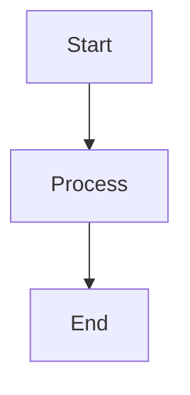

<!--<link rel="stylesheet" href="/assets/css/mycss.css"> -->


## test 123

<a href="http://www.facebook.com/{{site.facebook_username}}" target="_blank" class="has-text-black"><i class="fa fa-spotify"></i></a>

## My first post using jekyll

- [x] **Important task** (completed)
- [ ] *Regular task* (in progress)
- [ ] `Code review` for project
- [ ] [Link to documentation](https://example.com)
- [ ] ~~Cancelled task~~ (struck through)

|h1|h2|h3|
|-|-|-|
|data1|data2|data3|
|data1.1|data2.1|data3.1|

```powershell
Get-process

function get-myhelp {
  [cmdletbinding()]
  param (
    [string[]]$myhelprequest
  )
}
```

Add a gliffy

stop a gliffy

**Giphy Gifs will look like:**

<iframe src="https://giphy.com/embed/ZqlvCTNHpqrio" width="480" height="259" frameBorder="0" class="giphy-embed" allowFullScreen></iframe>

**YouTUbe Videos will look like:**

<iframe width="560" height="315" src="https://www.youtube.com/embed/VpEe4PntR2k?si=rlOTE1KFLKjOFaig" title="YouTube video player" frameborder="0" allow="accelerometer; autoplay; clipboard-write; encrypted-media; gyroscope; picture-in-picture; web-share" referrerpolicy="strict-origin-when-cross-origin" allowfullscreen></iframe>
